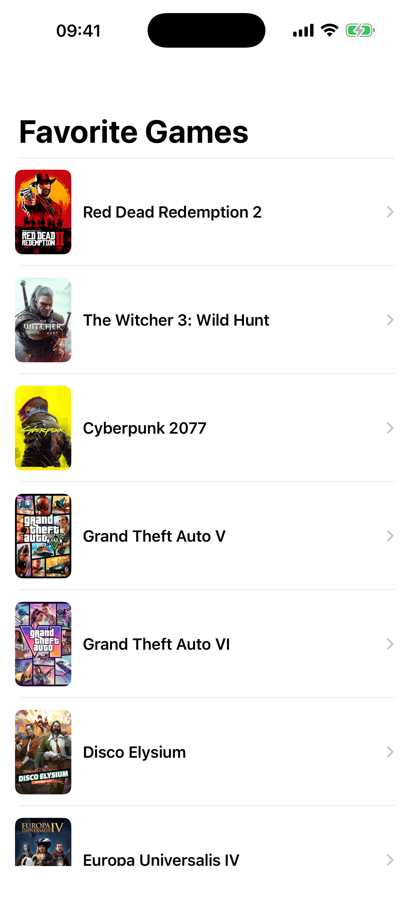
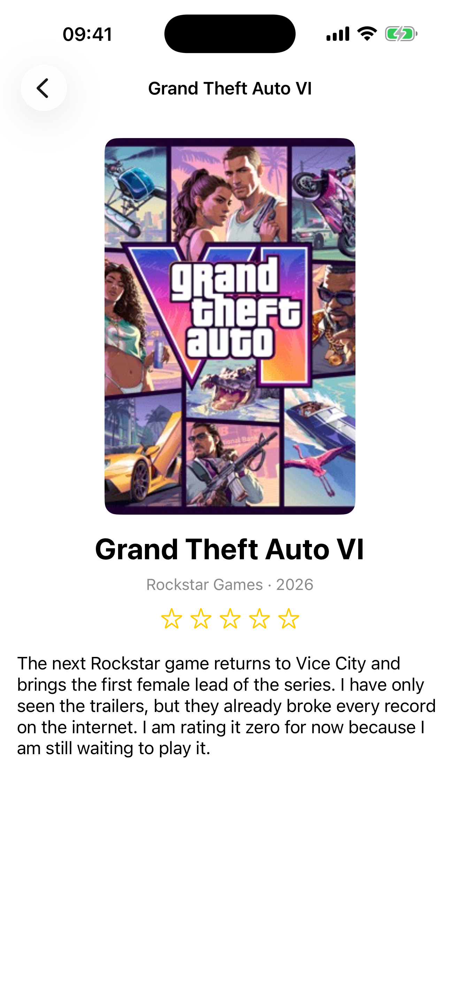
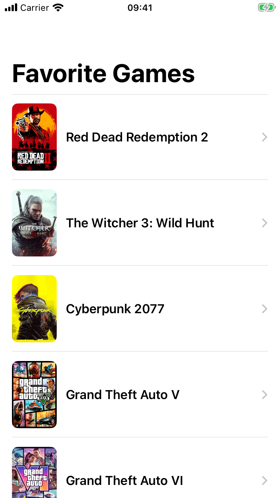
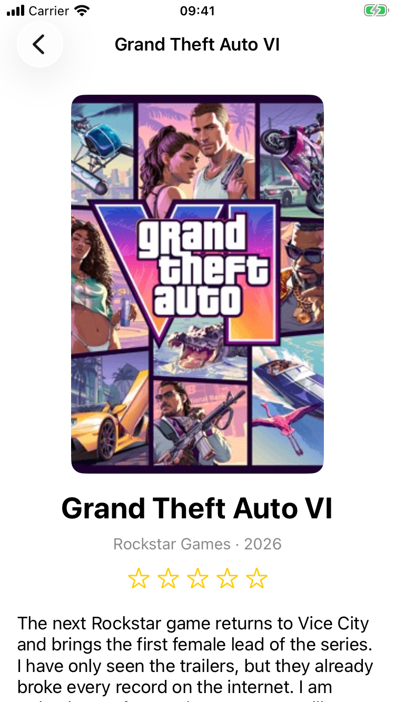
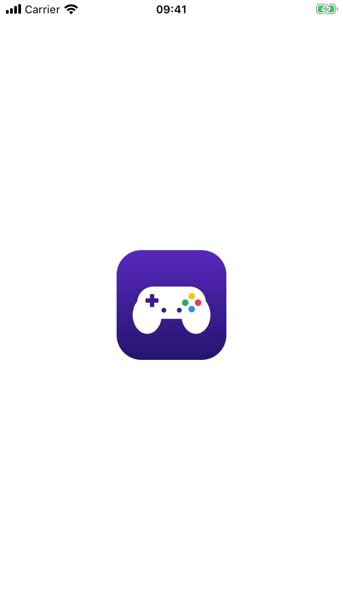
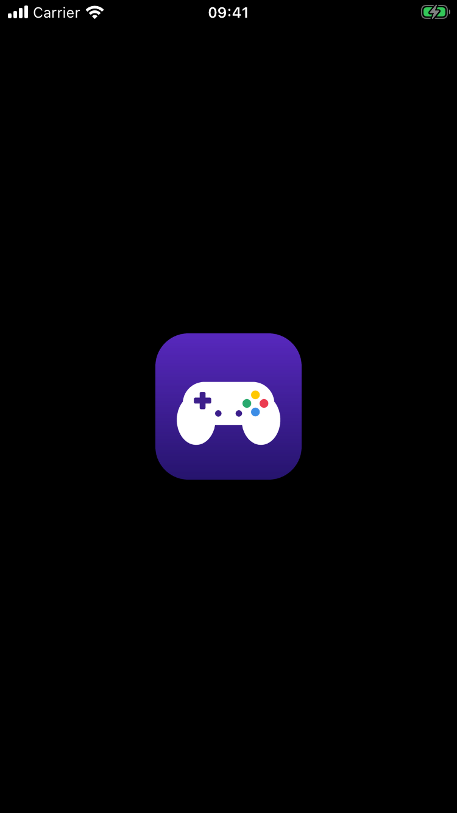
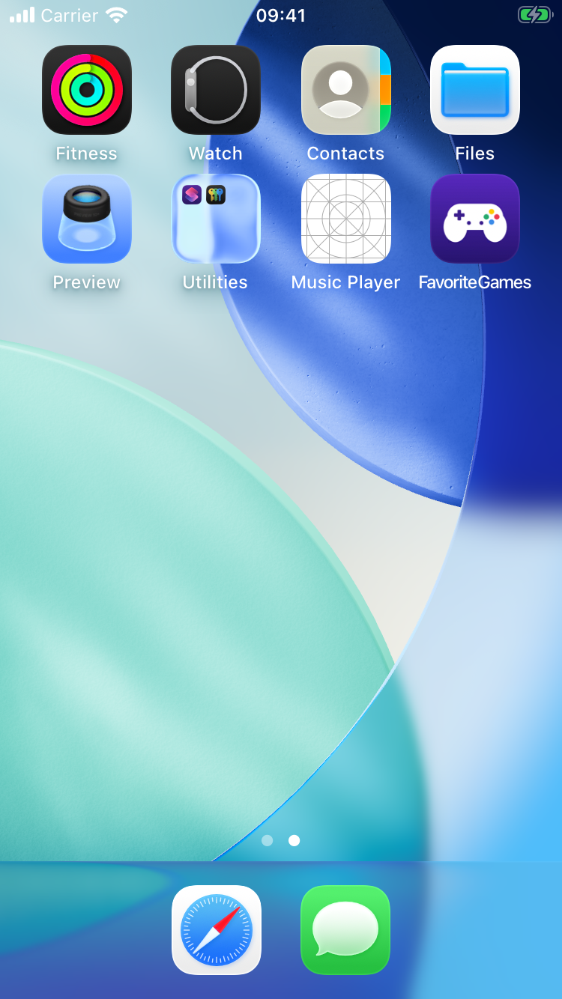

# Favorite Games: Navigator

**Author:** EraEKV (replace with your full name)
**Theme:** Games

UIKit app with a list of 20 favorite games inside a `UINavigationController`. A row shows only the cover and the title. Tapping it pushes a Detail screen with the large cover, title, developer and year, a 5-star rating (SF Symbols) and a description of at least three sentences.

## Storyboard

Everything is in `Main.storyboard`; `LaunchScreen.storyboard` is the launch screen.

- Navigation Controller is the initial view controller. Its bar has Prefers Large Titles on; the list title is "Favorite Games".
- List screen: table view pinned to the Safe Area, prototype cell `GameCell` (cover + title, disclosure indicator).
- A **Show segue** with identifier `showDetail` goes from the prototype cell to the Detail screen.
- Detail screen: scroll view pinned to the Safe Area, content view with cover (Aspect Fill, clipped, 2:3), title, subtitle, a rating stack of 5 star image views tagged 1...5, and a multi-line description (Lines = 0). Its navigation item uses a small title (Large Title: Never).

## Code

- `Game.swift`: `Game` struct (`title`, `subtitle`, `imageName`, `rating` 0 to 5, `description`)
- `GameLibrary.swift`: the array of 20 games
- `GameCell.swift`: outlets plus `configure(with:)`
- `GamesViewController.swift`: data source, `prepare(for:sender:)` (checks the identifier, casts `segue.destination`, takes the row from `indexPathForSelectedRow`, sets `item`), and deselects the row in `viewWillAppear`
- `DetailViewController.swift`: `var item: Game?`, fills its own outlets and the title in `viewDidLoad`

No `pushViewController`, `instantiateViewController`, constraints in code or frames.

## App Icon and Launch Screen

- `AppIcon` in `Assets.xcassets`: one 1024×1024 PNG, no transparency, square corners.
- `LaunchScreen.storyboard`: the logo centered with constraints on the system background color, so it works in Dark Mode.

## Screenshots

| List | Detail |
|---|---|
|  |  |

| iPhone SE list | iPhone SE detail |
|---|---|
|  |  |

| Launch Screen | Launch Screen (Dark) | App Icon on Home Screen |
|---|---|---|
|  |  |  |
