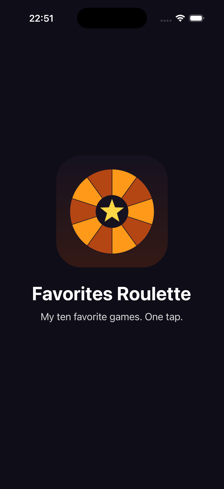
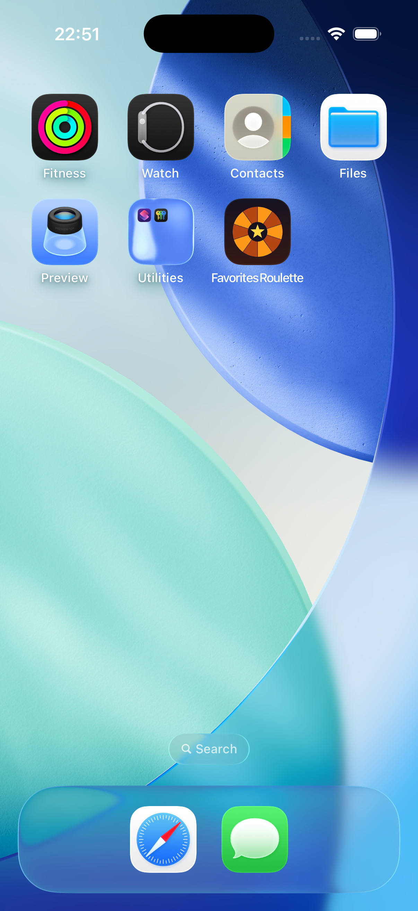

# Favorites Roulette

Single-screen iOS app (UIKit, Storyboard, Swift). Tap the button to see a random card from my 10 favorite games: image, title and short description. The same game never appears twice in a row.

- Layout in `Main.storyboard` (UIImageView, UILabel x2, UIButton), no Auto Layout constraints
- Data: `Favorite` struct + array of 10 items in `Favorite.swift`, images in `Assets.xcassets`
- Custom `LaunchScreen.storyboard` and `AppIcon` (1024x1024)

| Launch screen | Main screen | Home Screen icon |
|---|---|---|
|  |  |  |
