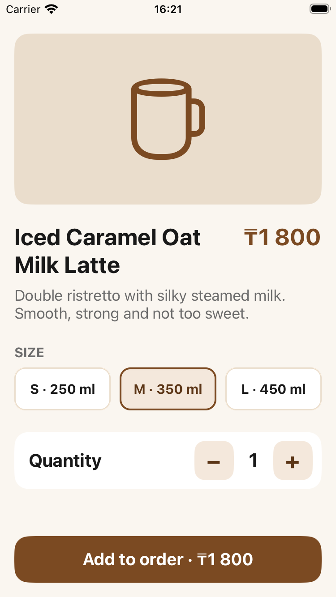
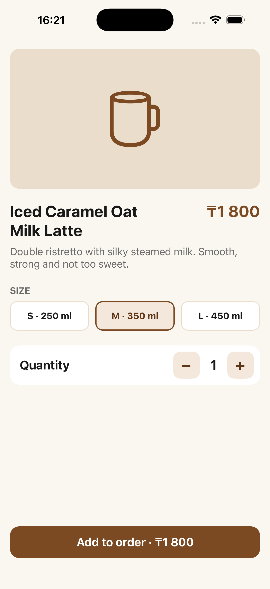

# Coffee Order (Variant B)

Single-screen iOS app (UIKit, Storyboard, Swift). All views and constraints are set in `Main.storyboard`, no `UIStackView`. Swift only fills in data.

- Image: 16:9 via Aspect Ratio constraint
- Title wraps, price has Compression Resistance 1000 and never truncates
- Size buttons: 3 equal widths (Equal Widths constraints), 10 pt gaps, 48 pt tall
- Quantity row: label on the left, custom stepper on the right
- Order button pinned to the safe-area bottom
- Side margins 16 pt, content inside the safe area

Long text test: title "Iced Caramel Oat Milk Latte" (change `name` in `Drink.swift`).

| iPhone SE (3rd gen) | iPhone Pro Max |
|---|---|
|  |  |
