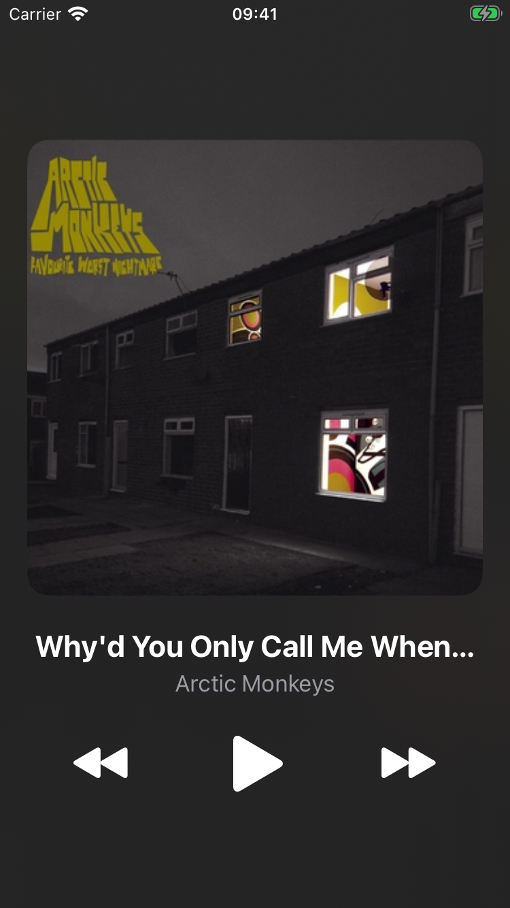
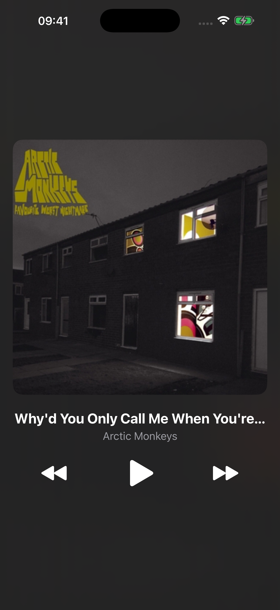

# Music Player

Single-screen music player in UIKit: cover, title, artist and Previous / Play-Pause / Next.

## Layout

All layout is in `Main.storyboard`, built with nested `UIStackView`s:

```
Root Stack (vertical, 20 pt from Safe Area, vertically centered)
├── Cover Image View (1:1)
├── Info Stack (vertical): title, artist
└── Controls Stack (horizontal, fill equally): previous, play/pause, next
```

The only constraints are the root stack's leading, trailing and center Y, plus the cover's 1:1 aspect ratio.

## Code

- `Track.swift`: `Track` struct (`title`, `artist`, `fileName`, `coverImageName`)
- `TrackLibrary.swift`: the list of 10 tracks
- `PlayerViewController.swift`: playback with `AVAudioPlayer`, loaded with `Bundle.main.url(forResource:withExtension:)`. Next/Previous wrap around and keep the play state, and the next track starts automatically via `audioPlayerDidFinishPlaying`. A missing file prints an error and shows an alert instead of crashing.

Audio files are in `MusicPlayer/Audio`, covers in `Assets.xcassets` (`cover01`...`cover10`).

## Screenshots

| iPhone SE (3rd gen) | iPhone 16 Pro Max |
|---|---|
|  |  |
