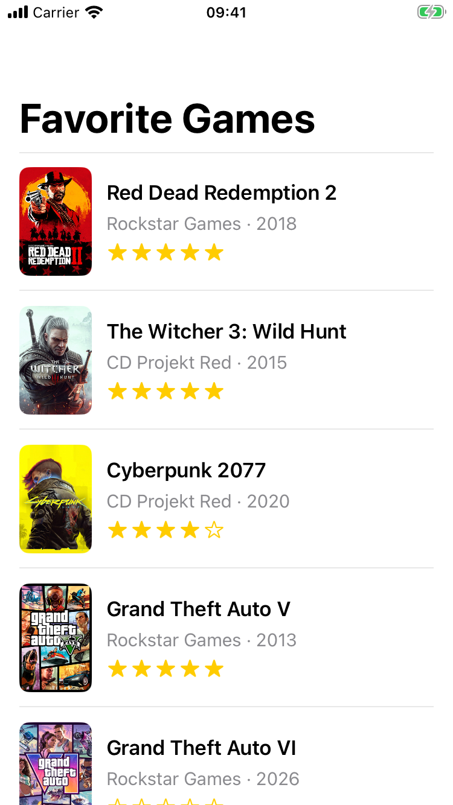
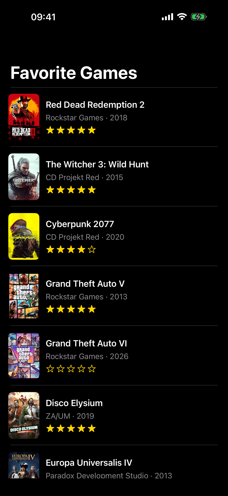

# Favorite Games

UIKit app with a `UITableView` listing 20 favorite games. Each row is a custom cell with a cover, title, developer and year, and a 5-star rating made of SF Symbols.

## Layout

All layout is in `Main.storyboard`. The cell is a prototype cell inside the table view (class `GameCell`, reuse identifier `GameCell`):

```
Content View
├── Cover Image View (60 × 90, leading 16, centered vertically)
└── Info Stack (vertical, 12 pt after the cover, trailing 16, centered vertically)
    ├── Title Label (multi-line)
    ├── Subtitle Label (multi-line)
    └── Rating Stack (horizontal, height 18): 5 star image views (18 pt wide) + spacer
```

Both the cover and the info stack are kept at least 12 pt from the top and bottom, so the row height follows whichever is taller. Long titles wrap instead of overlapping the cover. The table view fills the Safe Area under a navigation bar with a large title.

## Code

- `Game.swift`: `Game` struct (`title`, `subtitle`, `imageName`, `rating` from 0 to 5)
- `GameLibrary.swift`: the list of 20 games
- `GameCell.swift`: outlets only, plus `configure(with:)`, which resets every field on each dequeue. Stars are an outlet collection tagged 1...5; a star is filled when its tag is less than or equal to the rating.
- `GamesViewController.swift`: `UITableViewDataSource` (connected in the storyboard), one row per game, `dequeueReusableCell(withIdentifier:for:)` cast to `GameCell`

Covers are in `Assets.xcassets`, one image set per game.

## Screenshots

| iPhone SE (3rd gen) | iPhone 16 Pro Max |
|---|---|
|  |  |

## Screen recording

[Scrolling through the whole list](screenshots/scroll-recording.mov)
